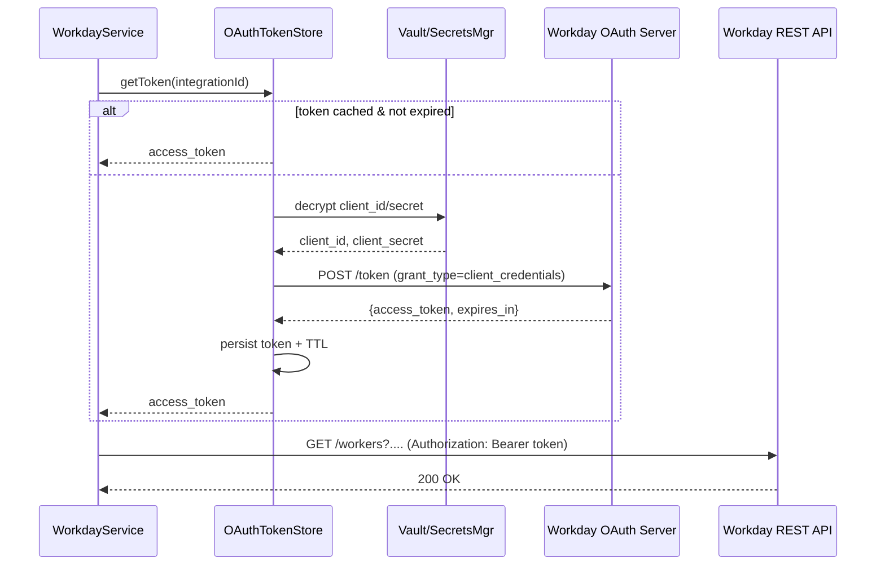

# 📦 REVER‑48 – Workday Integration  
**Owner:** @mau16ro  
**Target Repo:** `revert-api` (or the appropriate Revert services repository)  
**Sprint:** Q4‑2026  

---  

## 1. Visión General  

El objetivo es **exponer Workday como una integración disponible a través de los Revert APIs**.  
Esto implica:

| ✅ | Acción |
|---|---|
| 1️⃣ | Autenticarse contra Workday mediante **OAuth 2.0 (Client‑Credentials)** |
| 2️⃣ | Consumir los **end‑points REST** de Workday (empleados, puestos, unidades, etc.) |
| 3️⃣ | Normalizar la respuesta en los **modelos internos de Revert** |
| 4️⃣ | Gestionar de forma segura **las credenciales OAuth** y los **tokens de acceso** |
| 5️⃣ | Proveer una **API pública** (`/integrations/workday/*`) que siga el mismo estilo que el resto de los conectores (Salesforce, NetSuite, …) |
| 6️⃣ | Añadir **tests**, **monitorización** y **documentación** |

---  

## 2. Supuestos y Alcances  

| Tema | Detalle |
|------|---------|
| **Lenguaje / Stack** | La base del proyecto es **Node.js / TypeScript** con Express y un SDK interno (`@revert/sdk`). Si el proyecto está en Java, los conceptos son idénticos (se incluyen snippets en ambos). |
| **Almacenamiento** | PostgreSQL + Redis (caché). |
| **Secret Management** | Se dispone de **HashiCorp Vault** y/o **AWS Secrets Manager**. |
| **Entorno** | 3 entornos (dev, staging, prod). Cada uno tiene sus propias credenciales Workday. |
| **Versionado** | La integración se versionará como `v1` bajo `/integrations/workday/v1/...`. |
| **No** | No se implementa Webhooks ni eventos push de Workday (solo polling/GET). |
| **Sí** | Soporte para **paginación** y **filtrado** de los recursos más habituales (Workers, Organizations, Compensation). |

---  

## 3. Arquitectura Propuesta  

```mermaid
flowchart TD
    subgraph Revert API
        A[Express Router] --> B[WorkdayController]
        B --> C[WorkdayService]
        C --> D[WorkdayClient (REST)]
        C --> E[OAuthTokenStore]
    end
    subgraph External
        F[Workday REST API] <-- Token --> G[OAuth2 Server]
    end
    D --> G
    E --> G
    style Revert API fill:#f9f,stroke:#333,stroke-width:2px
    style External fill:#bbf,stroke:#333,stroke-width:2px
```

* **WorkdayController** – maneja los endpoints externos (`GET /integrations/workday/v1/workers`).  
* **WorkdayService** – contiene la lógica de negocio: decide cuándo refrescar token, aplica filtros, mapea datos.  
* **WorkdayClient** – thin wrapper sobre `axios` (Node) o `WebClient` (Java) que ejecuta llamadas HTTP a Workday.  
* **OAuthTokenStore** – capa de persistencia de credenciales y tokens (DB + Redis).  

---  

## 4. Modelo de Datos  

### 4.1 Tabla `integration_credentials`

| columna | tipo | descripción |
|--------|------|-------------|
| `id` | `uuid` | PK |
| `integration` | `varchar(50)` | `"workday"` (único) |
| `client_id` | `text` | Encriptado (AES‑256‑GCM) |
| `client_secret` | `text` | Encriptado (AES‑256‑GCM) |
| `tenant` | `varchar(100)` | Sub‑dominio de Workday (p.ej. `mycompany`) |
| `created_at` | `timestamptz` | |
| `updated_at` | `timestamptz` | |

> **Encriptado**: se usa la clave maestra de Vault (`secret/data/revert/aes-key`). La lógica de encriptado/desencriptado está centralizada en `src/common/crypto.ts`.

### 4.2 Tabla `oauth_tokens`

| columna | tipo | descripción |
|--------|------|-------------|
| `integration_id` | `uuid` | FK a `integration_credentials` |
| `access_token` | `text` | Encriptado |
| `expires_at` | `timestamptz` | |
| `scope` | `varchar(255)` | (opcional) |
| `created_at` | `timestamptz` | |
| **Índice** | `idx_oauth_tokens_expires` | `WHERE expires_at > now()` (para búsquedas rápidas) |

### 4.3 Cache en Redis  

Clave: `workday:token:{integration_id}` → JSON `{access_token, expires_at}` con TTL = `expires_at - now()`.

---  

## 5. Flujo OAuth 2.0 (Client Credentials)



**Puntos críticos**

* **Cache first**: siempre revisa Redis antes de ir a la DB.  
* **Refresh**: si `expires_at - now() < 30s`, solicita un nuevo token en background (optimistic).  
* **Rate‑limit**: Workday permite 1000 token requests / hour → `TokenRequestLimiter` (token bucket).  

---  

## 6. Implementación  

### 6.1 Estructura de carpetas (Node/TS)

```
src/
├─ integrations/
│  └─ workday/
│     ├─ controller.ts
│     ├─ service.ts
│     ├─ client.ts
│     ├─ oauth/
│     │   ├─ tokenStore.ts
│     │   └─ tokenProvider.ts
│     └─ mapper/
│         └─ workerMapper.ts
├─ common/
│  ├─ crypto.ts
│  └─ http.ts
└─ config/
   └─ integrations.ts
```

### 6.2 Código clave  

#### 6.2.1 `crypto.ts` (encriptado AES‑256‑GCM)

```ts
import crypto from 'crypto';
import { getSecret } from '../config/vault';

const ALG = 'aes-256-gcm';
const KEY_SECRET = 'revert/aes-key';

export async function encrypt(plain: string): Promise<string> {
  const key = Buffer.from(await getSecret(KEY_SECRET), 'base64');
  const iv = crypto.randomBytes(12);
  const cipher = crypto.createCipheriv(ALG, key, iv);
  const encrypted = Buffer.concat([cipher.update(plain, 'utf8'), cipher.final()]);
  const tag = cipher.getAuthTag();
  return Buffer.concat([iv, tag, encrypted]).toString('base64');
}

export async function decrypt(cipherB64: string): Promise<string> {
  const data = Buffer.from(cipherB64, 'base64');
  const key = Buffer.from(await getSecret(KEY_SECRET), 'base64');
  const iv = data.slice(0, 12);
  const tag = data.slice(12, 28);
  const encrypted = data.slice(28);
  const decipher = crypto.createDecipheriv(ALG, key, iv);
  decipher.setAuthTag(tag);
  const decrypted = Buffer.concat([decipher.update(encrypted), decipher.final()]);
  return decrypted.toString('utf8');
}
```

#### 6.2.2 `tokenStore.ts`

```ts
import { redisClient } from '../../common/redis';
import { db } from '../../db';
import { decrypt } from '../../common/crypto';

export class OAuthTokenStore {
  static async getToken(integrationId: string): Promise<string | null> {
    const cacheKey = `workday:token:${integrationId}`;
    const cached = await redisClient.get(cacheKey);
    if (cached) return JSON.parse(cached).access_token;

    const row = await db('oauth_tokens')
      .where({ integration_id: integrationId })
      .first();

    if (!row) return null;
    if (new Date(row.expires_at) <= new Date()) return null; // expired

    const token = await decrypt(row.access_token);
    // Populate Redis with proper TTL
    const ttl = Math.floor((new Date(row.expires_at).getTime() - Date.now()) / 1000);
    await redisClient.setex(cacheKey, ttl, JSON.stringify({ access_token: token }));
    return token;
  }

  static async saveToken(
    integrationId: string,
    token: string,
    expiresInSec: number,
    scope?: string,
  ): Promise<void> {
    const encrypted = await encrypt(token);
    const expiresAt = new Date(Date.now() + expiresInSec * 1000);

    await db('oauth_tokens')
      .insert({
        integration_id: integrationId,
        access_token: encrypted,
        expires_at: expiresAt,
        scope,
      })
      .onConflict('integration_id')
      .merge();

    const cacheKey = `workday:token:${integrationId}`;
    await redisClient.setex(cacheKey, expiresInSec, JSON.stringify({ access_token: token }));
  }
}
```

#### 6.2.3 `tokenProvider.ts`

```ts
import axios from 'axios';
import { OAuthTokenStore } from './tokenStore';
import { db } from '../../db';
import { decrypt } from '../../common/crypto';

export class WorkdayTokenProvider {
  private integrationId: string;

  constructor(integrationId: string) {
    this.integrationId = integrationId;
  }

  async getAccessToken(): Promise<string> {
    // 1️⃣ Try cache / DB
    const cached = await OAuthTokenStore.getToken(this.integrationId);
    if (cached) return cached;

    // 2️⃣ Need a new token → fetch credentials
    const cred = await db('integration_credentials')
      .where({ integration: 'workday', id: this.integrationId })
      .first();

    if (!cred) throw new Error('Workday credentials not configured');

    const clientId = await decrypt(cred.client_id);
    const clientSecret = await decrypt(cred.client_secret);
    const tenant = cred.tenant; // not encrypted, ok for URL

    // 3️⃣ Request token from Workday
    const tokenUrl = `https://${tenant}.workday.com/ccx/oauth2/${clientId}/token`;
    const resp = await axios.post(
      tokenUrl,
      new URLSearchParams({ grant_type: 'client_credentials' }).toString(),
      {
        auth: { username: clientId, password: clientSecret },
        headers: { 'Content-Type': 'application/x-www-form-urlencoded' },
      },
    );

    const { access_token, expires_in, scope } = resp.data;
    await OAuthTokenStore.saveToken(this.integrationId, access_token, expires_in, scope);
    return access_token;
  }
}
```

#### 6.2.4 `client.ts`

```ts
import axios, { AxiosInstance } from 'axios';
import { WorkdayTokenProvider } from './oauth/tokenProvider';
import { Logger } from '../../common/logger';

export class WorkdayClient {
  private http: AxiosInstance;
  private tokenProvider: WorkdayTokenProvider;
  private baseUrl: string;

  constructor(integrationId: string, tenant: string) {
    this.baseUrl = `https://${tenant}.workday.com/ccx/api/v1`;
    this.tokenProvider = new WorkdayTokenProvider(integrationId);
    this.http = axios.create({
      baseURL: this.baseUrl,
      timeout: 10_000,
    });

    // Request interceptor injects Bearer token
    this.http.interceptors.request.use(async (cfg) => {
      const token = await this.tokenProvider.getAccessToken();
      cfg.headers.Authorization = `Bearer ${token}`;
      return cfg;
    });
  }

  async